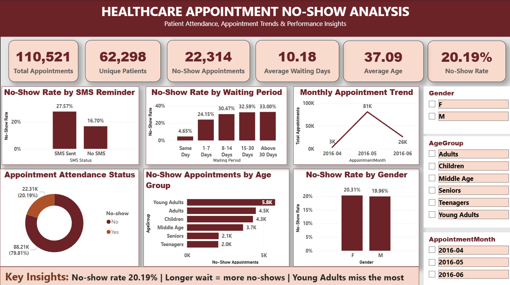

# Healthcare Appointment No-Show Analysis

An end-to-end data analytics project on 110,521 medical appointments (April to June 2016, Brazil). It uses **Python** for cleaning and EDA, **MySQL** for storage and analysis, and **Power BI** for an interactive one-page dashboard to find out why patients miss their appointments.

## Key findings

| Finding | Result |
|---|---|
| Overall no-show rate | **20.19%** (22,314 of 110,521 appointments) |
| Waiting time | No-show rate rises from **4.65%** (same day) to **33.00%** (above 30 days) |
| SMS reminders | SMS patients show a higher no-show rate (27.57% vs 16.70%), but they waited 19.0 days on average vs 6.0 days. Within every waiting group, SMS patients had a **lower** no-show rate (Simpson's paradox) |
| Age | Teenagers (26.05%) and Young Adults (23.83%) miss the most; Seniors the least (15.53%) |
| Gender | Almost no difference (20.31% female, 19.96% male) |

These are descriptive findings from observational data; they show association, not cause and effect. April and June are partial months (the data runs from 29 April to 8 June 2016), so the monthly trend reflects data coverage, not demand.

## Tools

Python (Pandas, Matplotlib, Seaborn) in Google Colab, MySQL 8.0 and MySQL Workbench, Power BI Desktop (DAX measures and calculated columns).

## Files

| File | Purpose |
|---|---|
| `KaggleV2-May-2016.csv` | Original dataset from Kaggle (110,527 rows, 14 columns) |
| `Healthcare_Appointment_Analysis.ipynb` | Python notebook: cleaning and EDA (Google Colab) |
| `Healthcare_Appointment_Cleaned.csv` | Cleaned dataset exported from the notebook (110,521 rows, 17 columns) |
| `Healthcare_Appointment_SQL.csv` | ASCII-normalised copy used for the MySQL import |
| `Healthcare_Appointment_Setup.sql` | Creates the database and the `appointments` table |
| `Healthcare_Appointment_Import.sql` | Loads the CSV into MySQL |
| `Healthcare_Appointment_Analysis.sql` | SQL analysis queries |
| `Healthcare_Appointment_No_Shows_Dashboard.pbix` | Power BI dashboard |
| `Healthcare_Appointment_No_Shows_Project_Report.pdf` | Full project report with screenshots |

## How to reproduce

1. **Data:** the original dataset (`KaggleV2-May-2016.csv`) is included in this repository. It comes from [Kaggle](https://www.kaggle.com/datasets/joniarroba/noshowappointments), where its license and description are listed.
2. **Cleaning and EDA:** run `Healthcare_Appointment_Analysis.ipynb` ([open in Colab](https://colab.research.google.com/drive/16Ff7P2ge2arI8KTCgSrsecJaTTXROTgg?usp=sharing)). It removes 6 invalid records (1 negative age, 5 negative waiting times), creates `WaitingDays`, `AgeGroup` and `AppointmentMonth`, and exports the cleaned file (110,521 rows, 17 columns).
3. **MySQL:** run the scripts in order: `Healthcare_Appointment_Setup.sql`, then `Healthcare_Appointment_Import.sql` (**run it only once**, running it twice loads the rows twice), then `Healthcare_Appointment_Analysis.sql`. The file path in the import script is specific to the author's computer: run `SHOW VARIABLES LIKE 'secure_file_priv';` to find your own folder and change the path. After the import, `SELECT COUNT(*) FROM appointments;` should return 110,521.
4. **Dashboard:** open `Healthcare_Appointment_No_Shows_Dashboard.pbix` in Power BI Desktop (it was built on the MySQL table).

## Data notes

- The `Healthcare_Appointment_SQL.csv` file is an ASCII-normalised copy of the cleaned data, created because the MySQL import failed with a character-map error.
- `PatientId` was read as a decimal number, so exported IDs end in `.0`. This does not affect the unique-patient count (62,298).

## Author

**Alisha Noor**, BS Software Engineering, University of Agriculture Faisalabad.

A full write-up with all screenshots is in `Healthcare_Appointment_No_Shows_Project_Report.pdf`.
